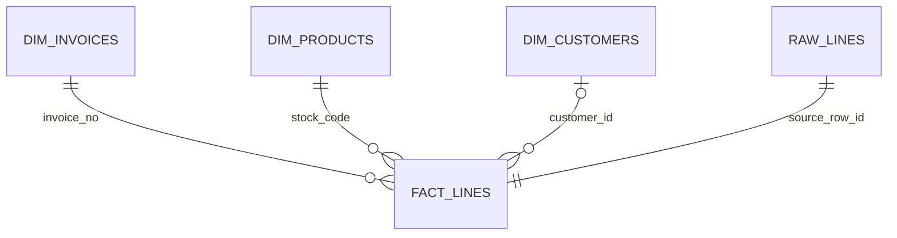
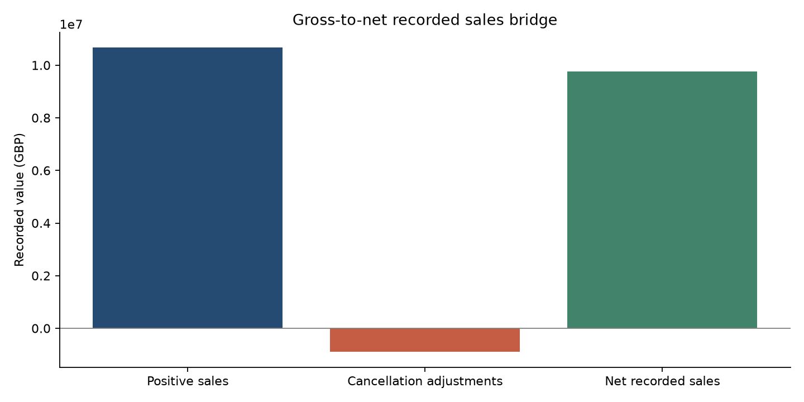
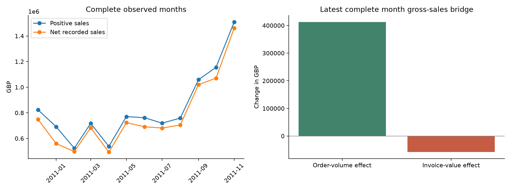
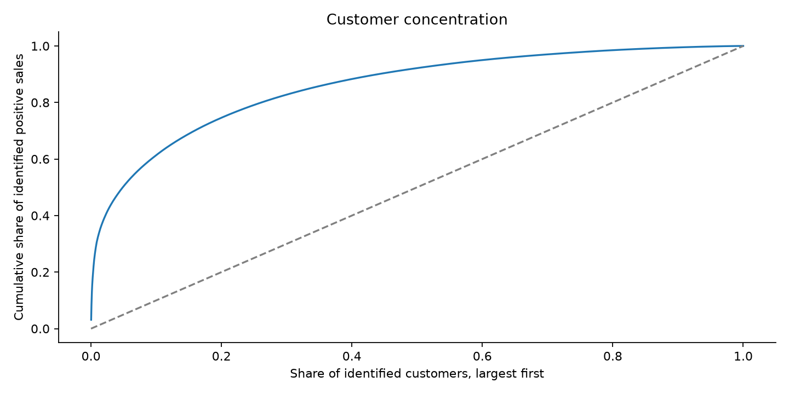
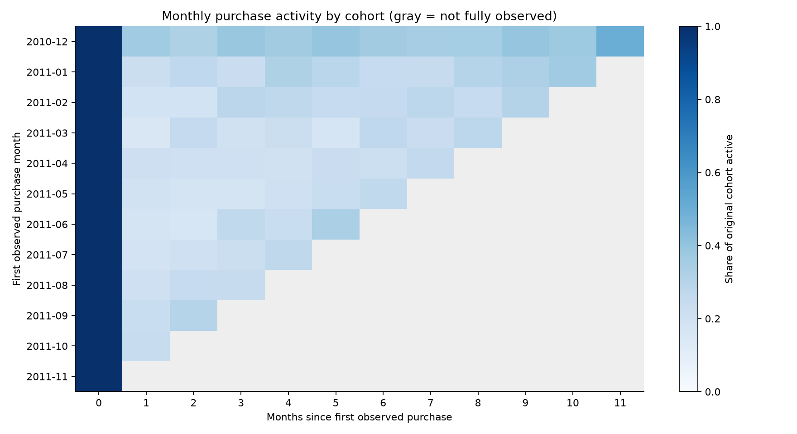

# Revenue Quality & Customer Concentration — SQL Business Analysis

**Is recorded sales growth supported by repeat purchasing and a broad customer base—or weakened by cancellations and dependence on a few large customers?**

This project turns 541,909 invoice lines into a reconciled management analysis. DuckDB SQL owns the definitions, transformations, joins, aggregations, window calculations, and reporting views. Python handles file loading and presentation. The executed notebook shows the SQL and interprets each step rather than only displaying a final dashboard.

## The management story

The eligible ledger contains **£10.67 million in positive sales**, offset by **£896,812 in cancellation adjustments**, leaving **£9.77 million in net recorded sales value**. November 2011 growth is volume-led, while average positive invoice value declines. Among identified purchasers, the top ten contribute **17.3%** of positive sales. The data support focused investigations into adjustment records, major accounts, and repeat purchasing; they do not establish actual savings or accounting profit.

The strongest caveats are part of the findings: **16.5% of positive value has no customer ID**, the two largest adjustment lines account for **27.4% of adjustment value**, and December 2011 is incomplete. A useful management report must expose these limits before drawing conclusions.

## 1. Establish trustworthy definitions before calculating KPIs

The original workbook is preserved, and each source line receives a stable row ID. SQL casts quantities, prices, and dates. Monetary arithmetic uses fixed-point decimals, retaining fractional-price precision until presentation.

The fact table has invoice-line grain. Separate invoice, product, and customer dimensions support explicit relationships. Product descriptions use one latest observed description per code; country stays on the transaction rather than being assumed to be a permanent customer attribute. Dimension uniqueness and join preservation are checked.



These are logical relationships validated by SQL checks, rather than a claim that all source fields are complete or physically constrained with foreign keys.

| Definition | Policy |
|---|---|
| Positive sale | Positive price and quantity, non-cancellation invoice, valid required fields |
| Negative adjustment | Negative quantity with positive price; C-prefixed invoices are separately labeled cancellations |
| Net recorded sales value | Eligible positive values minus eligible negative adjustments |
| Purchase invoice | Distinct invoice containing eligible positive-sale lines |
| Customer concentration | Positive sales attributed to identified customers only |
| Monthly repeat activity | Share of a first-observed purchase cohort buying in a particular later calendar month |
| Product scope | Five-digit code with an optional letter; a product-like proxy, not verified taxonomy |

Administrative codes remain in financial totals but are excluded from the product watchlist. The net contribution of non-product-like codes is **−£6,175.16**, disclosed separately. The financial measure therefore reflects recorded eligible transaction value, not exclusively merchandise revenue.

**How this answers the problem:** common definitions prevent different queries from telling inconsistent versions of the sales story.

## 2. Inspect data quality without quietly deleting inconvenient records

The SQL audit identifies **2,515 zero-value lines**, **two negative-price lines**, and **5,268 exact repeated lines after the first occurrence**. Positive sales and eligible adjustments comprise **539,392 lines**. Unknown customers remain in overall financial totals.

Exact repeats are preserved in the primary analysis because identical invoice entries are not automatically proven errors. Keeping only the first occurrence is a separate sensitivity: eligible net value would fall from **£9,769,872.05** to **£9,748,131.07**, a difference of **£21,740.98**. This quantifies the policy effect without assuming deletion is correct.

All 25,900 source invoice numbers have at most one identified customer, one country, and one calendar date in this file. That supports the dimension structure, while not certifying that every source transaction is valid.

**Interpretation:** customer-level conclusions cannot cover all sales when identifiers are missing. Source quality is a business limitation, not just a technical cleanup exercise.

SQL: [preparation and dimensions](sql/01_prepare.sql), [quality checks and repeat sensitivity](sql/02_quality.sql).

## 3. Reconcile the gross-to-net bridge

| Recorded measure | Value |
|---|---:|
| Eligible positive sales | £10,666,684.54 |
| Cancellation adjustments | −£896,812.49 |
| Other eligible negative adjustments | £0.00 |
| **Eligible net recorded sales** | **£9,769,872.05** |



Adjustment value equals **8.4%** of eligible positive sales. It is a period-value ratio, not an order-return probability. Credits are not authoritatively linked to original invoices; original sales may precede the observation window.

A separate bridge explains the difference from the raw signed-value sum of **£9,747,747.93**: two negative-price entries totaling **−£22,124.12** are excluded under the stated positive-price policy. They remain auditable. No typed source value disappears from the reconciliation.

The largest cancellation line is **£168,469.60** for product 23843 on December 9, 2011. The second is **£77,183.60** for product 23166 on January 18. Together they represent **27.4%** of adjustment value.

**Interpretation:** adjustments materially affect the headline total, but a small number of large records contribute heavily. Validate those records and reasons before concluding there is a widespread product or fulfillment issue. A credit note does not prove an avoidable loss or cash refund.

SQL: [reconciliation and large-record investigation](sql/03_reconcile.sql).

## 4. Explain growth through invoice volume and value

`GROUP BY` creates monthly measures, `LAG` retrieves the prior month, and window functions calculate rolling trends. December 2010 through November 2011 are treated as complete observed months; December 2011 ends on the ninth and is excluded from comparable growth.



In **November 2011**, net recorded sales increased **36.5%** from October. Positive sales increased by **£354,517.03**, decomposed as:

- **+£412,735.25 from invoice-volume change**, valued at prior-month average invoice value.
- **−£58,218.22 from average invoice-value change**, valued at current-month invoice volume.

The two effects exactly reconcile gross growth. This is a declared sequential arithmetic decomposition; it does not identify causal drivers or separate prices from product/customer mix.

**Interpretation:** the latest complete month's growth comes from more recorded purchase invoices, while average positive invoice value falls. Management could investigate customer/product mix and volume planning. One observed annual window cannot distinguish seasonality from sustained growth. Comparing partial December with November would give a misleading trend.

SQL: [monthly reporting and growth bridge](sql/04_monthly.sql).

## 5. Measure dependence on major accounts

`ROW_NUMBER` ranks identified customers by positive sales. A cumulative window measures how quickly value accumulates among the largest accounts. The table also retains adjustments and net value for each customer; `DENSE_RANK` supports country comparisons.



Among **4,338 identified purchasers**, the top ten supply **17.3%** of identified positive sales. The top 1%, rounded up to 44 customers, supply **32.0%**.

**Interpretation:** a relatively small set of accounts materially affects gross recorded activity. However, two gross-sales top-ten customers have almost all their recorded value cancelled: customer 12346 has £77,183.60 in positive sales and zero net value, while customer 16446 has £168,472.50 positive value and only £2.90 net. Gross account size therefore is not lasting sales contribution. Review gross and net values together before prioritizing account relationships. Concentration is measured on positive sales to avoid unstable shares when individual net totals are negative. The denominator excludes unidentified customer value, which is **16.5% of all positive sales**; these percentages must not be presented as total-company concentration or a prediction of customer loss.

SQL: [customer concentration and country reporting](sql/05_concentration.sql).

## 6. Distinguish repeat purchasing from cohort maturity

Customers enter the month of their first **observed** positive purchase. The earliest cohort can include existing customers, so this is not verified acquisition history. Distinct customer-month activity avoids counting frequent purchasers multiple times.

The SQL creates all fully observed cohort-month cells before joining purchases. No activity in an observable month becomes zero; future or partial months are excluded. This prevents incomplete follow-up from being mistaken for churn.



**23.7%** of the **3,974 customers** in cohorts with a fully observed next month bought in that next calendar month. Across the entire observation window, **65.6%** of identified purchasers had at least two positive purchase invoices.

**Interpretation:** these rates answer different questions. A customer can buy again later without buying in month one. Different customers have different follow-up lengths, so the whole-window repeat rate is not a standardized retention measure. Later cohort-age rates involve different eligible cohorts and cannot establish increasing loyalty among the same people. The analysis supports targeted investigation and measured follow-up, not a proven retention campaign effect.

SQL: [first-observed cohorts and purchase frequency](sql/06_cohorts.sql).

## 7. Turn unusual product ratios into an investigation queue

The product report joins aggregates to a unique product dimension. The watchlist requires at least **£10,000 positive value** and **20 purchase invoices**, then sorts by adjustment-value ratio. These declared thresholds reduce low-volume noise; they are not an optimized operational policy.

Product **23166, Medium Ceramic Top Storage Jar**, has **£81,700.92** positive sales, **£77,479.64** adjustments, and **£4,221.28** net value: a **94.8%** adjustment-value ratio. Its £77,183.60 large adjustment shows why transaction-level investigation is essential.

**Interpretation:** this is a priority for source-document review, not evidence that 94.8% of orders were returned or that the product is defective. Credit-note timing, corrections, and bulk orders can dominate the value ratio. Validate the product-code scope before using it as a verified merchandise taxonomy.

SQL: [product reporting and watchlist](sql/07_products.sql).

## 8. Validate the result and inspect performance

All **nine SQL integrity checks pass**: financial bridges, monthly totals, growth decomposition, cohort bounds, invoice/product/line uniqueness, and product-join row preservation. Three fixture tests additionally verify monetary signs and scope, unknown-customer inclusion, repeat-line treatment, and zero activity versus unobserved cohort months.

The project records an `EXPLAIN ANALYZE` plan for a filtered product-sales join and aggregate. It demonstrates inspection of scans, filters, joins, and timings. No optimization speedup is claimed without a controlled comparison.

**Interpretation:** the outputs reconcile under the stated rules. This does not certify source correctness or remove the need for invoice and adjustment verification.

SQL: [integrity checks](sql/08_checks.sql), [query-plan inspection](sql/09_query_plan.sql). [Financial logic tests](tests/test_financial_logic.py).

## Conclusion: business outcome and theoretical impact

The business outcome is a **reconciled view of sales quality**, rather than a headline gross total. The latest complete month's increase is volume-led; adjustments are material and concentrated in a few large entries; major identified accounts contribute substantial value; repeat activity depends on observation period; and missing IDs limit customer coverage.

A finance or commercial team could use this repeatable SQL reporting structure to monitor sales bridges, investigate exceptional adjustments, track major-account exposure, and compare purchase cohorts consistently. If source validation and measured interventions prove effective, it could improve planning and reduce avoidable adjustments. The dataset does not demonstrate that outcome, and it does not provide costs, margins, payment collection, budgets, or cancellation reasons.

The evidence supports four priorities:

1. **Validate the largest adjustments** and obtain credit-note reasons and original-invoice links.
2. **Improve customer-ID capture** before claiming comprehensive customer concentration or retention.
3. **Monitor major accounts** and investigate the mix behind volume-led growth.
4. **Review flagged product transactions**, then test any operational response with measured outcomes.

The measure is **net recorded sales value**, not accounting revenue, profit, cash collected, or proven avoidable loss. More history, verified product/customer reference data, costs, and adjustment linkage would support stronger decisions.

## Reproduce locally

Use Python 3.12 and the pinned dependencies. DuckDB is an embedded SQL database; no server or credentials are needed.

```bash
python3.12 -m venv .venv
source .venv/bin/activate
python -m pip install -r requirements.txt
python src/run_pipeline.py
python -m unittest discover -s tests
```

Then open [revenue_quality_sql.ipynb](revenue_quality_sql.ipynb) in VS Code, select the project `.venv`, and run all cells from the project root. The pipeline downloads the source if absent and creates the database and report exports. The notebook can recreate a missing database, shows the SQL, and generates interpreted figures and conclusions.

The local project already contains the source, database, executed notebook, and outputs. A clean checkout excludes the downloaded workbook and generated database; the loader reconstructs them. Versions used are in [environment_versions.txt](environment_versions.txt).

## Deliverables and SQL competence

| Deliverable | Demonstrated skill |
|---|---|
| [Numbered SQL scripts](sql/01_prepare.sql) | Typed staging, conditional logic, CTEs, aggregations, joins, views |
| [Growth bridge](sql/04_monthly.sql) | `LAG`, rolling windows, exact financial decomposition |
| [Concentration](sql/05_concentration.sql) | Ranking and cumulative shares with explicit denominators |
| [Cohorts](sql/06_cohorts.sql) | Date arithmetic, distinct activity, calendar joins, maturity handling |
| [Executed notebook](revenue_quality_sql.ipynb) | A reproducible business story with query outputs |
| [Conclusion](reports/conclusion.md) | Evidence-based interpretation and priorities |
| [Query plan](reports/query_plan.txt) | Performance inspection |
| [Data manifest](data/manifest.json) | Provenance and source hash |

## Source and attribution

Chen, D. (2015). *Online Retail* [Dataset]. UCI Machine Learning Repository. [Dataset documentation](https://archive.ics.uci.edu/dataset/352/online+retail), [DOI 10.24432/C5BW33](https://doi.org/10.24432/C5BW33). CC BY 4.0. Recorded amounts are GBP; source timestamps run from **2010-12-01 08:26:00** to **2011-12-09 12:50:00**.

Source SHA-256: `43465a06f2ccf7c8b5bd2892bc7defb52f97487934fe93b16ae4c3936424676d`. The raw workbook is preserved and all policy exclusions remain auditable. No real-world intervention or financial saving has been measured.
